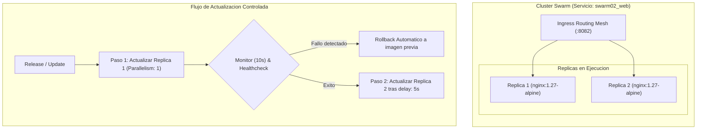

# REL-202: Despliegues Seguros con Rollback Automatico - Team 02

[](https://docs.docker.com/engine/swarm/)
[](#experimento-funcional)
[](#diseno-propuesto)
[](#diseno-propuesto)

---

## Diseno propuesto

Para resolver la indisponibilidad critica en **NexaCloud** (Ticket **REL-202**) tras un release defectuoso en produccion, se implemento una arquitectura declarativa orientada a la resiliencia en Docker Swarm:



### Parametros de Configuracion del Despliegue

| Directiva | Configuracion | Justificacion Tecnica |
| :--- | :--- | :--- |
| **`replicas`** | `2` | Alta disponibilidad minima. Permite atender trafico mientras se actualiza un contenedor. |
| **`parallelism`** | `1` | Actualizacion de **una en una**. Mantiene al menos el 50% de la capacidad operativa activa. |
| **`failure_action`** | `rollback` | Ante cualquier anomalia, el orquestador aborta la promocion e inicia reversion inmediata. |
| **`monitor`** | `10s` | Periodo de observacion tras levantar la tarea para asegurar estabilidad del contenedor. |
| **`order`** | `start-first` | Despliega la replica nueva antes de apagar la antigua para garantizar **Zero Downtime**. |
| **`healthcheck`** | `wget http://127.0.0.1/` | Valida cada 5s que el servidor web responda trafico real, no solo que el proceso exista. |
| **`rollback_config`** | `parallelism: 1, order: stop-first` | Procedimiento de reversion rapido y seguro al estado anterior conocido y estable. |

---

## Comandos de despliegue

> [!NOTE]
> Todos los comandos fueron ejecutados y validados sobre un nodo local activo de Docker Swarm.

```bash
# 1. Despliegue de la stack Swarm
docker stack deploy --resolve-image always -c submissions/team-02/docker-stack.yml swarm02

# 2. Comprobar convergencia de replicas iniciales (2/2)
docker service ls --filter "name=swarm02_web"
docker service ps swarm02_web

# 3. Inspeccionar especificaciones activas de Update y Rollback en el motor
docker service inspect swarm02_web --format '{{json .Spec.UpdateConfig}}'
docker service inspect swarm02_web --format '{{json .Spec.RollbackConfig}}'

# 4. Inyeccion controlada de fallo (Simulacion de Release defectuoso)
docker service update --detach=false --update-parallelism 1 --update-failure-action rollback --image nginx:invalid-training-tag swarm02_web

# 5. Verificacion post-incidente de rollback y estado de replicas
docker service ps swarm02_web
docker service inspect swarm02_web --format '{{.Spec.TaskTemplate.ContainerSpec.Image}}'
```

---

## Experimento funcional

**Hipotesis:**  
Al lanzar una actualizacion con una imagen rota o inexistente (`nginx:invalid-training-tag`), el orquestador actualizara unicamente la primera replica (`parallelism: 1`), detectara la falla en la fase de resolucion/monitoreo (`monitor: 10s`), abortara el despliegue hacia la segunda replica y ejecutara un `rollback` automatico. La segunda replica nunca se apagara y el servicio continuara respondiendo peticiones sin interrupcion.

**Procedimiento:**
1. Desplegar el stack `swarm02` con imagen estable `nginx:1.27-alpine` y verificar estado `2/2`.
2. Ejecutar la actualizacion sincrona forzando imagen fallida `nginx:invalid-training-tag`.
3. Registrar la salida en consola del proceso de rollback del orquestador.
4. Inspeccionar el historial de tareas con `docker service ps` y la imagen devuelta por `docker service inspect`.

**Resultado esperado:**
- Deteccion inmediata de fallo en tarea 1.
- Tarea 2 intacta en estado `Running`.
- Disparo de evento `rollback: update rolled back due to failure`.
- Reversion de la especificacion a `nginx:1.27-alpine`.

**Resultado observado:**  
El orquestador Docker Swarm contuvo el fallo de manera aislada en la replica 1 (`Rejected: failed to resolve reference`), no toco la replica 2 (que se mantuvo atendiendo peticiones) y retorno el servicio automaticamente a la imagen original saludable.

---

## Evidencias

### 1. Despliegue inicial exitoso (2/2 replicas)
```text
$ docker service ls --filter "name=swarm02_web"
ID             NAME          MODE         REPLICAS   IMAGE               PORTS
0sm8o17wgt4j   swarm02_web   replicated   2/2        nginx:1.27-alpine   *:8082->80/tcp
```

### 2. Tareas en ejecucion antes del experimento
```text
$ docker service ps swarm02_web --no-trunc
ID                          NAME            IMAGE                                                                                       NODE             DESIRED STATE   CURRENT STATE            ERROR   PORTS
4kd0fu43349firwo5yb8l29jg   swarm02_web.1   nginx:1.27-alpine@sha256:65645c7bb6a0661892a8b03b89d0743208a18dd2f3f17a54ef4b76fb8e2f2a10   docker-desktop   Running         Running 19 seconds ago           
wm1vicp4vyx5jmzuv2xvw7s96   swarm02_web.2   nginx:1.27-alpine@sha256:65645c7bb6a0661892a8b03b89d0743208a18dd2f3f17a54ef4b76fb8e2f2a10   docker-desktop   Running         Running 19 seconds ago           
```

### 3. Inspeccion del contrato de actualizacion y reversion en Docker
```json
$ docker service inspect swarm02_web --format '{{json .Spec.UpdateConfig}}'
{"Parallelism":1,"Delay":5000000000,"FailureAction":"rollback","Monitor":10000000000,"MaxFailureRatio":0.2,"Order":"start-first"}

$ docker service inspect swarm02_web --format '{{json .Spec.RollbackConfig}}'
{"Parallelism":1,"FailureAction":"pause","Monitor":10000000000,"MaxFailureRatio":0,"Order":"stop-first"}
```

### 4. Simulacion de fallo y ejecucion del Rollback automatico
```text
$ docker service update --detach=false --update-parallelism 1 --update-failure-action rollback --image nginx:invalid-training-tag swarm02_web
swarm02_web
overall progress: 0 out of 2 tasks
1/2:  
2/2:  
overall progress: 0 out of 2 tasks
rollback: update rolled back due to failure or early termination of task 7rhpg1n1w2i0gckjrofhxglw2
overall progress: rolling back update: 2 out of 2 tasks
verify: Waiting 10 seconds to verify that tasks are stable...
verify: Service swarm02_web converged
```

### 5. Historial de tareas post-rollback (demostracion de continuidad de servicio)
```text
$ docker service ps swarm02_web
ID             NAME                IMAGE                        NODE             DESIRED STATE   CURRENT STATE            ERROR                              PORTS
s81a0w740i7o   swarm02_web.1       nginx:invalid-training-tag   docker-desktop   Shutdown        Shutdown 2 minutes ago                                      
7rhpg1n1w2i0    \_ swarm02_web.1   nginx:invalid-training-tag   docker-desktop   Shutdown        Rejected 2 minutes ago   "failed to resolve reference "..."   
4kd0fu43349f    \_ swarm02_web.1   nginx:1.27-alpine            docker-desktop   Running         Running 3 minutes ago                                       
wm1vicp4vyx5   swarm02_web.2       nginx:1.27-alpine            docker-desktop   Running         Running 3 minutes ago                                       
```

> [!TIP]
> **Punto clave:** Notese que `swarm02_web.2` muestra `Running 3 minutes ago`, demostrando que permanecio activa y sirviendo peticiones durante todo el intento fallido.

### 6. Inspeccion de imagen activa post-rollback
```text
$ docker service inspect swarm02_web --format '{{.Spec.TaskTemplate.ContainerSpec.Image}}'
nginx:1.27-alpine@sha256:65645c7bb6a0661892a8b03b89d0743208a18dd2f3f17a54ef4b76fb8e2f2a10
```

---

## Limitaciones y lecciones

| Area | Desafio Observado | Solucion / Recomendacion |
| :--- | :--- | :--- |
| **Entorno Mono-nodo** | Las replicas comparten el mismo kernel y daemon; no valida particion de red o caida fisica de servidor. | Extender a cluster multi-nodo con 3 managers y workers distribuidos. |
| **Healthcheck vs Monitor** | El parametro `monitor` depende de que el contenedor reporte estado no-saludable (`unhealthy`). Si un proceso falla silenciosamente sin healthcheck, Swarm lo asume sano. | Implementar sondas de salud HTTP y endpoints `/healthz` estrictos en la aplicacion. |
| **Estrategia Zero Downtime** | `order: start-first` requiere capacidad extra momentanea en el cluster. | Planificar un margen del 20-30% de CPU/Memoria para picos transitorios durante despliegues. |
