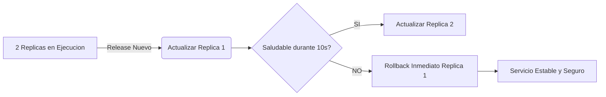

# Guion de Presentacion - Team 02

[](#1-incidente-y-objetivo-1-min)
[](#1-incidente-y-objetivo-1-min)
[-purple?style=flat-square)](#estructura-de-la-exposicion)
[](#1-incidente-y-objetivo-1-min)

> **Regla de Tiempo:** Exposicion de 7 minutos + 3 minutos de preguntas y debate en mesa redonda.

---

## Estructura de la Exposicion

```mermaid
gantt
    title Cronograma de la Presentacion (10 Minutos)
    dateFormat  m
    axisFormat %M min
    section Presentacion (7 min)
    1. Incidente y objetivo     :active, 0, 1m
    2. Arquitectura y decisiones: 1, 3m
    3. Demo y evidencia         : 3, 6m
    4. Trade-offs y limites     : 6, 7m
    section Preguntas (3 min)
    5. Mesa redonda             :crit, 7, 10m
```



---

## 1. Incidente y objetivo (1 min)

* **Contexto del Problema:**
  - En NexaCloud, un release defectuoso en produccion provoco una caida completa del portal de clientes.
  - El despliegue previo se realizo "a ciegas" (todo el servicio a la vez), sin escalonamiento ni mecanismos de monitoreo activo ni reversion asistida.
* **Mision de Platform Engineering:**
  - Implementar una estrategia de **Rolling Updates** controlada sobre Docker Swarm.
  - Asegurar **Zero Downtime**: mantener capacidad operativa disponible en todo momento.
  - Automatizar la deteccion y reversion (`rollback`) inmediata ante cualquier fallo de imagen o fallo de salud.

---

## 2. Arquitectura y decisiones (2 min)



* **Puntos clave de diseno:**
  1. **`replicas: 2`**: Redundancia basica requerida para no dejar el servicio sin respaldo.
  2. **`parallelism: 1`**: Actualizacion gradual (50% de la flota permanece atendiendo peticiones).
  3. **`failure_action: rollback`**: Eliminacion de la intervencion humana en caso de desastre.
  4. **`monitor: 10s` + `healthcheck`**: Ventana de validacion donde el contenedor debe responder peticiones HTTP reales.
  5. **`order: start-first`**: El nuevo contenedor se inicializa y pasa chequeos antes de dar de baja el contenedor antiguo.

---

## 3. Demo: comandos y evidencia (3 min)

| Fase | Comando Demostrativo | Resultado Visible |
| :--- | :--- | :--- |
| **1. Estado Sano** | `docker service ls --filter "name=swarm02_web"` | `2/2` replicas activas en `nginx:1.27-alpine`. |
| **2. Inyeccion de Fallo** | `docker service update --image nginx:invalid-training-tag swarm02_web` | Swarm rechaza la imagen y emite `rollback: update rolled back`. |
| **3. Prueba de Continuidad** | `docker service ps swarm02_web` | **La Replica 2 nunca cayo** (`Running`). Replica 1 regreso a la version estable. |
| **4. Validacion Final** | `docker service inspect ... ContainerSpec.Image` | Especificacion restaurada automaticamente en `nginx:1.27-alpine`. |

---

## 4. Trade-offs y limites (1 min)

* **Trade-offs Asumidos:**
  - *Velocidad vs. Fiabilidad:* Desplegar replica por replica con `monitor: 10s` y `delay: 5s` hace el despliegue mas pausado, pero elimina por completo caidas de servicio.
  - *Sobrecarga temporal de recursos:* `order: start-first` requiere capacidad de computo adicional temporal mientras conviven la version anterior y la nueva.
* **Limites de la prueba mono-nodo:**
  - En un solo nodo no se evaluan caidas fisicas de servidor ni problemas de latencia o particion en la red overlay multi-nodo.

---

## 5. Preguntas de la mesa redonda (3 min)

### Que incidente resolvieron y que trade-offs asumieron?
> **Respuesta:** Resolvimos la indisponibilidad total del portal debida a releases defectuosos masivos. Asumimos como trade-off un tiempo de despliegue ligeramente mayor (`parallelism: 1` + `monitor: 10s`) y un buffer transitorio de memoria/CPU (`start-first`) a cambio de garantizar disponibilidad continua y recuperacion autonoma sin necesidad de guardias reactivas.

### Que comando demuestra el resultado, en vez de solo mostrar YAML?
> **Respuesta:** El comando:
> ```bash
> docker service ps swarm02_web
> ```
> Demuestra que la replica 2 (`swarm02_web.2`) se mantuvo ininterrumpidamente en estado `Running` durante todo el incidente, mientras que la replica 1 muestra el fallo aislado (`Rejected`) seguido del rollback exitoso. Ademas, `docker service inspect` confirma que la imagen final activa es la version estable original.

### Que limitacion tiene su prueba en un unico nodo?
> **Respuesta:** Al ejecutarse en una sola maquina virtual / host, todos los contenedores comparten el mismo socket de Docker, kernel de Linux y memoria RAM. No permite simular el aislamiento real ante fallos de hardware, particiones de red inter-nodo ni balanceo de trafico ingress distribuido.

### Que cambiarian para una instalacion de produccion?
> **Respuesta:**
> 1. Despliegue en cluster multi-nodo con topologia de alta disponibilidad (minimo 3 Managers y multiples Workers con reglas de anti-afinidad).
> 2. Imagenes inmutables ancladas por digest criptografico (`image@sha256:...`) firmadas mediante Docker Content Trust / Cosign.
> 3. Monitoreo avanzado con Prometheus, alertas automaticas de rollback en tiempo real y dashboards de latencia en Grafana.
> 4. Healthchecks de aplicacion avanzados que validen conectividad con base de datos y dependencias criticas.
